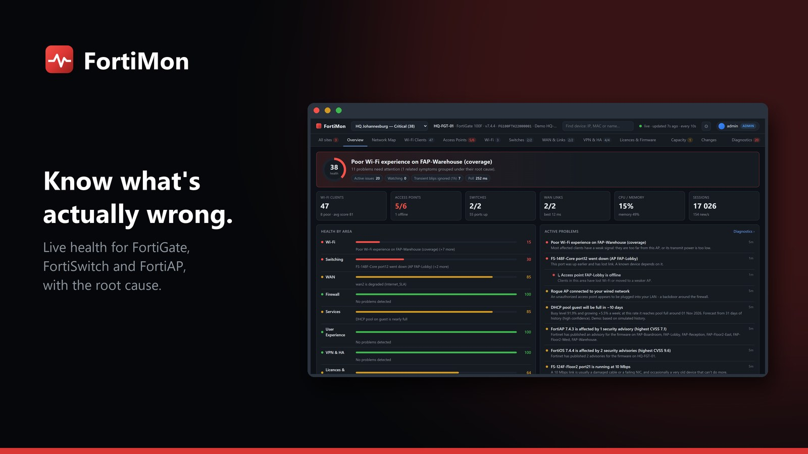
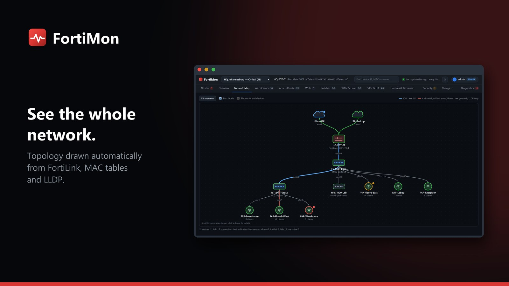

# FortiMon

**Live network monitoring for Fortinet that tells you what is actually wrong.** FortiMon reads your FortiGates over the
FortiOS REST API and serves a live dashboard on a server you run yourself: site health, problems with their likely cause,
Wi-Fi, switches, WAN links, VPN and history. No agents, no cloud service, and free to use.

FortiMon is part of [MonStack](https://github.com/RowShack/MonStack), a family of monitoring apps that share one look, one sign-in model and the
same signed updates.

## What it does

Its diagnostics try to tell you whether something is **really** wrong, and why, instead of alerting on every blip.

- **Health at a glance.** A 0-100 health score and a plain-language verdict for every site, with the worst problem first.
- **Problems with a cause.** Each issue shows its evidence, the likely cause, related Fortinet known issues and a
  recommended fix. If both internet links drop at once, it reports one shared cause, not two ISP faults.
- **An automatic network map** of internet links, firewalls, switches, access points and other devices.
- **Wi-Fi, switches and WAN.** Every client's experience score, FortiSwitch faceplates with port speed, PoE and errors,
  SD-WAN SLA, throughput and DHCP pool use.
- **VPN and HA.** IPsec tunnels, dial-up users and the HA pair, including failovers.
- **Licences, firmware and advisories.** Expiry dates, firmware status and the Fortinet security advisories that apply to you.
- **Capacity forecasts.** When DHCP pools, WAN links, PoE or the firewall will run out.
- **Configuration changes** for the last 30 days: who changed what, when, with old and new values.
- **Alerts** to Microsoft Teams, webhooks and email, grouped so they do not flood a channel, plus scheduled reports.
- **A NOC wallboard** for a TV, many sites, users with roles, two-step sign-in, backup and restore.
- **Demo mode** with three simulated sites, so you can look around without a FortiGate.

More screenshots are in the [user guide](docs/user-guide.md).

## Quick install

Download the files from the [latest release](https://github.com/RowShack/FortiMon/releases/latest).

- **Windows:** double-click `FortiMon-<version>.msi` and answer the questions (run as a service, who may connect, port).
- **Linux:** `sudo sh fortimon-<version>-linux.run` (systemd and Python 3.9 or newer).

Open `https://<server>:8443/`, create the first admin account, then add a FortiGate under **Settings > Sites**. The
[setup guide](docs/setup.md) covers the details, including the read-only API user to make on the FortiGate and how to check
a download.

## Documentation

- [Setup guide](docs/setup.md): install, make the API user on the FortiGate, first sign-in, add a site.
- [Configuration reference](docs/configuration.md): every Settings section, the data folder and the command line.
- [User guide](docs/user-guide.md): every tab, with screenshots.
- [FAQ](docs/faq.md): common problems and questions.

## Help and feedback

- **Questions, bugs and ideas:** [open an issue](https://github.com/RowShack/FortiMon/issues/new/choose). Please give the version and
  your operating system, and never paste tokens, passwords, configuration files or customer data.
- **Security problems:** please do not use public issues. See [SECURITY.md](SECURITY.md) to report them privately.
- The other apps and the overall picture: [MonStack](https://github.com/RowShack/MonStack).

## Licence

FortiMon is free to use and closed source. Read the [licence](LICENSE): you may install and use it, but not copy, sell,
modify or reverse engineer it.

Fortinet, FortiGate, FortiSwitch, FortiAP and FortiOS are trademarks of their owners. FortiMon is an independent product and
is not affiliated with or endorsed by them.
