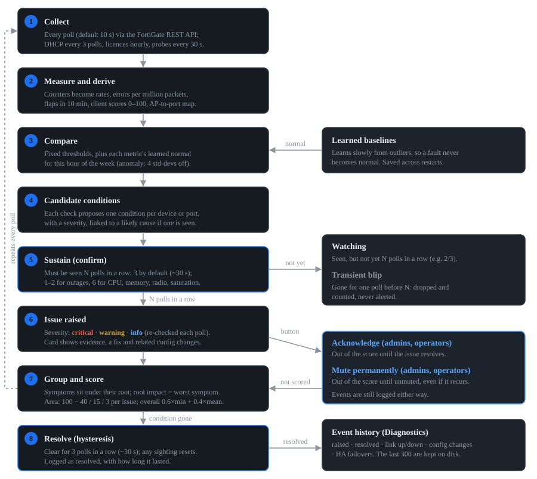
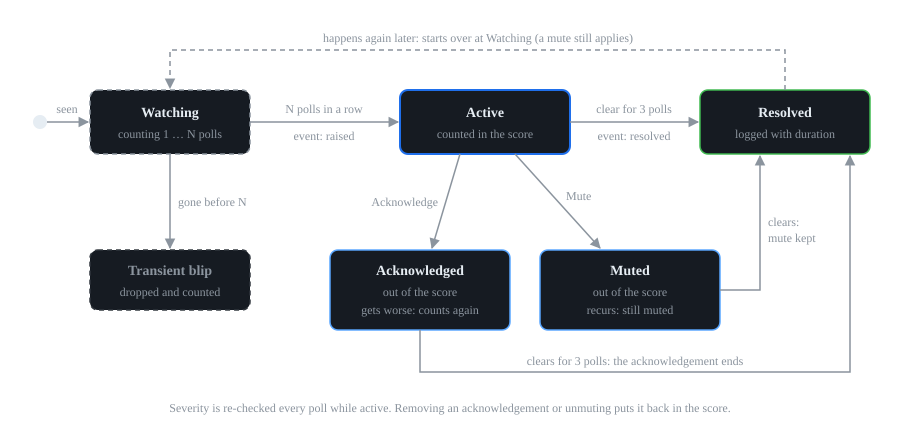

# How FortiMon's diagnostics work

This guide explains what you see on the **Overview** and **Diagnostics** tabs: when an issue appears, how serious it is, why it stays or clears, and what acknowledging and muting do. It is written for network admins and helpdesk staff using the dashboard.

## In one paragraph

FortiMon reads your FortiGate (and its FortiAPs and FortiSwitches) over the REST API every few seconds and runs a set of checks on what it finds. It does not alert on every blip. A condition has to last for several polls in a row before it becomes an issue, and it has to stay gone for several polls before the issue resolves. Many checks compare a value with what is *normal for that time of the week*, not just with a fixed limit. When one fault causes several others, FortiMon links them, so you see the cause (for example a switch port) with its effects (an access point offline) grouped underneath, instead of a list of unrelated alarms.

## From a poll to an issue



The whole pipeline runs once per poll, for each site separately.

1. **Collect.** FortiMon reads the FortiGate's REST API every poll. The poll interval is 10 seconds by default (*Settings > Monitoring*, 5 to 300 seconds). Data that changes slowly is read less often and the last answer is reused in between:
  - every 2 polls: the switch MAC table (used for loop detection and finding which port feeds each AP);
  - every 3 polls: DHCP leases and the wireless and system event logs;
  - every 6 polls: device status, rogue APs, switch health (temperature, PoE, power supplies), SFP light levels, LLDP;
  - hourly: licences and firmware. Capacity forecasts are recalculated every 10 minutes from stored history.
  - The user-experience probes run on their own timer, every 30 seconds by default, from the FortiMon server.
2. **Measure and derive.** Counters are turned into rates (traffic, errors per second and per minute, errors per million packets). Up/down changes are remembered, so FortiMon knows whether a link *was* up (within the last 24 hours, also across restarts) and how often it changed state in the last 10 minutes. Every Wi-Fi client gets a 0–100 experience score. Each AP is matched to the switch port that feeds it, using the switch MAC table; the last known port is remembered so an offline AP can still be traced.
3. **Compare.** Each check compares its values with fixed thresholds (see *Tuning*) and, for some metrics, with a **learned baseline**. The baseline is what is normal for this hour of the week (Monday 09:00 is compared with other Mondays at 09:00). While that is still being learned, FortiMon uses the same hour on any day, then the overall average. A value counts as abnormal when it is 4 standard deviations away from normal (`anomaly_z`). Baselines learn only slowly from unusual values, so a fault that lasts a while does not become the new normal. They are saved, so they survive a restart.
4. **Candidate conditions.** Each check proposes a condition for one specific thing, for example "port12 on FS-148F-Core went down" or "WAN member wan2 has 4% packet loss", with its own severity. Where a likely cause is visible in the same poll, the condition is linked to it (see *Root cause and symptoms*).
5. **Sustain (confirm).** A condition becomes an issue only once it has been seen in **N polls in a row**. N is 3 by default (`confirm_polls`, about 30 seconds), but each check has its own count:
  - 1 poll for things that are already conclusive: a missing API permission, flapping links and tunnels, a network loop, a rogue AP on the wire, RADIUS timeouts, licences, firmware, capacity forecasts and HA failovers;
  - 2 polls for outages: the FortiGate API unreachable, a WAN member, interface, AP, switch or VPN tunnel down, an important switch port down, DHCP pools, most Wi-Fi login problems and most probe failures;
  - 6 polls (about a minute) for values that naturally spike: CPU, memory, channel congestion, radio noise, link saturation, poor Wi-Fi on an AP, fibre light drifting down;
  - 9 polls for HA configuration out of sync, 12 polls for "most clients on 2.4 GHz".
  - While a condition is counting up it is listed under *Diagnostics > Watching (not yet confirmed)* with its progress, for example "2/3 polls". If it is missing from even one poll before it reaches N, it is dropped and counted under **Transient blips ignored**. It is never alerted.
6. **Issue raised.** The issue appears with its severity, a short explanation, the evidence behind it, a recommended action and, where relevant, recent configuration changes. A "raised" event is written to the event history. While the issue stays active, its details and severity are re-checked every poll, so a warning can become critical (or the other way round). This doesn't log a new event, except when an acknowledged issue gets worse (see *Acknowledging and muting*).
7. **Group and score.** Symptoms are grouped under their root cause, the root cause takes on the severity of what it breaks (its *impact*), and each health area gets a score. See *Severity, impact and the health score*.
8. **Resolve (hysteresis).** An issue resolves once its condition has been absent for **3 polls in a row** (`clear_polls`, about 30 seconds). If the condition is seen again during those polls, the count starts again. A "resolved" event is written with how long the issue lasted, and it moves to *Recently resolved*.

**While the FortiGate API is unreachable** nothing that depends on FortiGate data can be checked, so those issues (and conditions still being watched) are **held** exactly as they were: they are not counted as clear, don't resolve, and keep their acknowledgements. They are re-checked on the first poll after the FortiGate answers again and carry on as the same issues. Only the probe checks, which run from the FortiMon server, keep being evaluated. A single failed poll changes nothing: **Cannot reach the FortiGate API** needs 2 failed polls in a row, and only then does the health score drop to 0.

**Note on slow-changing data.** Because some data is read less often than every poll (see step 1), FortiMon reuses the last reading in between. For checks based on that data, the confirm and clear counts are counted in **fresh readings**, not polls, so seeing the same old answer again proves nothing. For example, a probe failure (confirm 2) needs two probe runs, about a minute at the default 30 seconds, and a DHCP pool (read every 3 polls) needs two DHCP readings. This applies to the probes, DHCP pools, switch temperature and hardware alerts, SFP light levels, the Wi-Fi event log checks, loops and MAC flapping, and HA members leaving or missing. "HA configuration out of sync" is the exception: its 9 polls are meant as about 90 seconds.

## Severity, impact and the health score

### Severity levels

| Severity | Meaning | Examples |
|---|---|---|
| **Critical** | Something is down or users are clearly affected now | WAN member down, AP or switch that was up has gone offline, network loop, DNS not working for anyone, a link between switches running below 1 Gbps |
| **Warning** | Degraded, or will hurt soon if nobody acts | 4% packet loss on a WAN link, CPU at 85%, port errors, DHCP pool 85% full, licence expiring in 20 days |
| **Info** | Worth knowing, no action needed unless users complain | A switch port went down, weak clients on healthy APs, a FortiOS upgrade is available, a capacity forecast within 90 days |

### Impact (effective severity)

An issue's own severity describes the thing itself. Its **impact** is the worst severity among the live (not acknowledged or muted) issues it causes. When the two differ, the issue card shows an extra **impact:** badge.

Example: a switch port going down is only **info** on its own, because devices get unplugged all the time. If that port fed an access point and the AP is now offline (critical), the port issue shows *info* with *impact: critical*, and it is the port, not the AP, that counts in the score.

### The health score

Each health area starts at 100 and loses points for every root-cause issue in it, using the issue's impact:

| Impact | Points deducted |
|---|---|
| Critical | 40 |
| Warning | 15 |
| Info | 3 |

An area never goes below 0. Only root causes count: a symptom whose cause is a live issue is not counted again. Acknowledged and muted issues don't count at all, and neither do issues on anything [excluded from the score](#score-exclusions). The area's status is **critical** if any counted issue has critical impact, **degraded** if the worst is a warning, **attention** if there are only info notes, otherwise **healthy**.

The overall score combines the areas so that one bad area can't hide behind several good ones:

```
overall = 0.6 × (lowest area score) + 0.4 × (average of all area scores)
```

With the standard nine areas, a single critical issue gives about 74, a single warning about 90 and a single info note about 98. When the FortiGate API can't be reached, the overall score is 0. On the Overview, the score ring is green from 80, amber from 60 and red below that.

The health areas on the Overview are:

| Area | Covers |
|---|---|
| Wi-Fi | Access points, radios, clients, Wi-Fi logins, rogue APs |
| Switching | FortiSwitches, their ports and optics, LAN interfaces, loops |
| WAN | SD-WAN members and WAN interfaces |
| Firewall | The FortiGate itself: reachability, API access, CPU, memory, sessions |
| Services | DHCP pools |
| User experience | The probes run from the FortiMon server |
| VPN & HA | IPsec tunnels and the HA cluster |
| Licences & firmware | FortiCare and FortiGuard contracts, firmware versions |
| Capacity | Forecasts of when things run out |

The filter chips on the Diagnostics tab split Wi-Fi into **Access points** and **Wi-Fi & clients** to make the list easier to scan. That doesn't change the scoring.

The headline at the top of the Overview is the most serious root-cause issue. The summary line counts the problems that need attention and says how many related symptoms were grouped under them.

## Root cause and symptoms

When FortiMon can see that one issue explains another, it marks the second as a **symptom** ("symptom of ..." on the card, "↳" in lists) and the first as the **root cause** ("root cause of N other issues"). The symptom stays visible with its own evidence, but only the root counts in the score.

| Root cause | Symptoms grouped under it |
|---|---|
| The switch feeding an AP is offline | That AP offline, suddenly has no clients, or has poor Wi-Fi |
| The switch port feeding an AP went down or is flapping | That AP offline, suddenly has no clients, or has poor Wi-Fi |
| Errors on the switch port feeding an AP | Poor Wi-Fi on that AP (not "AP offline": errors don't take an AP down) |
| All SD-WAN members of one health check failing at once | Each member's own issue |
| A WAN interface link down | That SD-WAN member's issue |
| Wi-Fi poor across the site (10+ clients, 40%+ of them poor, on 3+ APs) | Each AP's "poor Wi-Fi experience" issue |
| A DHCP pool nearly full | "Wi-Fi devices are not getting an IP address" on an SSID that pool serves |

Three examples:

- **AP offline traced to its switch port.** The lobby AP drops off. In the same polls, port12 on the core switch lost link. You see one critical problem: the port (info, *impact: critical*) with "Impact: Access point FAP-Lobby is offline" in its evidence, and the AP issue underneath it marked as a symptom with "Root cause: FS-148F-Core port12 went down (AP FAP-Lobby)". If you acknowledge the port, the AP issue counts again on its own, so acknowledging a cause never hides a live outage.
- **All WAN links failing together.** Two independent ISPs rarely fail at the same moment. When every member of a health check (at least two) is down or degraded at once, FortiMon raises one issue, "All links failing health-check 'Internet_SLA'", and groups the members under it. The recommended action points at what the links share: the health-check probe server, FortiGate CPU, or an upstream device. It is as serious as the worst member: critical when a link is down, a warning when they are all only slow or jittery.
- **Wi-Fi logins failing after a configuration change.** Many devices start failing to join the Guest SSID. The issue card shows "Started 2 min after a configuration change", with who changed `wireless-controller.vap` 'Guest', when and from where. Because the change names the affected SSID, it is marked **likely**.

**Configuration changes.** FortiMon reads admin changes from the FortiGate's system event log. Any change made up to 30 minutes before an issue started (`change_window_min`), in a part of the configuration that can affect that area, is shown on the issue card (up to three, the likely ones first). A change is **likely** when it names the affected object, such as the SSID, port or interface; otherwise it is marked *same area*. Problems that configuration can't cause are never linked to a change: cable and port errors, port down and flapping, optics, interface errors, noise, switch temperature and hardware alerts, single clients, band balance, and the FortiGate being unreachable. A linked change is a hint for you; it doesn't change the severity or the score.

**Users affected or not.** When an SD-WAN member is degraded but every probe from inside the network is healthy, the WAN issue gets the extra evidence "Users are not affected", because traffic is flowing over a working link. The severity stays the same.

## The life of an issue



- **Watching.** The condition has been seen but not yet for N polls in a row.
- **Transient blip.** It disappeared before reaching N. It is counted (the Overview shows how many in the last hour) but never raised.
- **Active.** It counts in the health score and appears in the issue lists, on the Overview and in the drill-down of the affected device.
- **Resolved.** It was absent for 3 polls in a row. It moves to *Recently resolved* with how long it lasted. If the same condition comes back later, it starts again at Watching and is raised as a new issue.

### Acknowledging and muting

Admins and operators see two buttons on every active issue. Both take an optional note, are saved to disk, are recorded in the audit log, and move the issue to *Diagnostics > Acknowledged & muted*. Several issues can be acknowledged or muted at once with the tick boxes.

| | Acknowledge | Mute permanently |
|---|---|---|
| Use it for | "We know, we're on it" | "This is expected here", for example a printer that only does 10 Mbps |
| Counts in the health score | No | No |
| Counts in the area status, headline and problem counts | No | No |
| Still listed | Under *Acknowledged & muted* | Under *Acknowledged & muted*, even while it isn't happening |
| Events still logged | Yes | Yes |
| Ends when | The issue resolves (or someone removes it) | Someone unmutes it |
| If the problem comes back | Raised again as a normal issue | Still muted |
| If it gets worse while still active | The acknowledgement ends and it counts again; an **escalated** event is logged | Stays muted |

Things to know:

- Both act on one exact issue for one device or port, for example `port-speed` on FS-124F port7. Some checks report a whole site in one issue (for example "weak connections on healthy APs", "devices repeatedly failing to log in", "devices moving between switch ports", "Internet is slower than normal"); muting those mutes the check for the whole site.
- "Worse" means more serious than when it was acknowledged: a warning acknowledged as a warning that turns critical comes back. An issue acknowledged while critical that eases to a warning and returns to critical stays acknowledged. Acknowledgements made with an older version take the issue's severity the first time it is seen after the upgrade.
- Acknowledging a root cause does not hide its symptoms: they count on their own again.
- **Remove** (for an acknowledgement) and **Unmute** put the issue straight back in the score.

### Score exclusions

Some parts of a network aren't business critical, for example a guest SSID or a lab switch. Admins and operators can leave them out of the health score under *Diagnostics > Score exclusions*, on the Wi-Fi tab (SSIDs), or from an AP, switch or port drill-down. Exclusions are per site, saved to disk and recorded in the audit log.

| Excluded | Leaves out of the score |
|---|---|
| SSID | Wi-Fi login failures on it, its own interface, and networks and DHCP pools used only by its clients (not a LAN VLAN it shares with other devices); its clients are left out of the Wi-Fi experience checks (AP experience, site-wide Wi-Fi) and the client stats |
| Access point | All issues on that AP and its radios |
| Switch | All issues on the switch and its ports |
| Port | All issues on that port |
| Network | Issues on that FortiGate interface or VLAN, its DHCP pool, or that WAN member |

Excluded issues are still raised, listed (after the ones that count, marked *not in score*), logged in the event timeline, and still colour the device on the map and tabs. They don't count in the health score, the area status, the headline or the problem counts, and they don't raise the impact of a root cause. Site-wide issues (the FortiGate itself, licences, probes) can't be excluded; mute them instead.

### What Diagnostics shows

The filters at the top combine: **area** chips, **severity** chips (critical, warning, info; active issues use their impact), **problem type** chips (from the check that raised the issue, for example *Flapping ports*, *Slow links (10/100 Mbps)*, *Ports down*, *APs offline*, with counts) and a search box. They apply to every list on the tab, and *Select all* then picks only what's shown.

| Section | What it is |
|---|---|
| Active issues | Live issues, most serious first, with symptoms under their root |
| Acknowledged & muted | Issues and mutes kept out of the score, with when and the note (who did it is in the audit log) |
| Watching (not yet confirmed) | Conditions counting up, with "count/needed polls" |
| Transient blips ignored | Conditions that cleared before they were confirmed, with how many polls they lasted |
| Event timeline | The latest events: issues raised and resolved, ports, APs, interfaces and tunnels going up and down, configuration changes, HA failovers |
| Recently resolved | Resolved issues with how long they lasted |
| Stored event history | The last 300 events, kept on disk, so they survive a restart |
| FortiGate API endpoints | Each data set FortiMon reads, whether it works, and what is lost without it |

**After a restart** FortiMon restores its baselines, the event history, acknowledgements and mutes. Issues that were active when it stopped keep their original start time if they are confirmed again, and are not logged as new. Any that don't come back within 15 polls are logged as resolved.

## What each area checks

Times assume the default 10-second poll. "Confirm" is the number of polls in a row before the issue is raised (fresh readings, for data read less often; see *Note on slow-changing data*). Threshold names in `code` can be changed (see *Tuning*).

### Wi-Fi: access points

| Check | Triggers when | Severity | Confirm |
|---|---|---|---|
| Access point offline | The AP is known to the controller but not connected | Critical if it was up in the last 24 hours, otherwise warning | 2 |
| AP suddenly has no clients | It normally has 5 or more clients at this time, now 0, while online | Info (people may simply have left; check it if users complain) | 3 |
| Poor Wi-Fi experience on an AP | At least `ap_min_clients` (3) clients and at least `ap_poor_ratio` (40%) of them scoring below `client_poor_score` (60) | Warning; critical if 70% or more of at least 5 clients | 6 |
| Channel congestion | A radio's channel utilisation at or above `chan_util_warn` (70%) | Warning; critical at `chan_util_crit` (85%) | 6 |
| High noise floor | Noise at or above `noise_warn` (−80 dBm) | Warning | 6 |
| Most clients on 2.4 GHz | Dual-band AP with 6 or more clients and 60% or more on 2.4 GHz | Info | 12 |

A poor-experience issue says *why*, based on the poor clients:
- **coverage** if at least 60% of them have a weak signal (below `signal_poor`, −75 dBm);
- otherwise **congestion** if the busiest radio is at 70% utilisation or more;
- otherwise **interference** if at least half of the rest have low SNR (below `snr_poor`, 20 dB);
- otherwise **mixed** (retries and low data rates).

### Wi-Fi: clients and logins

**Client experience score.** Every client starts at 100. The bigger of the signal and SNR penalties is taken off, then retries and data rate:

| Measure | Points off |
|---|---|
| Signal below −80 dBm (`signal_bad`) / below −75 (`signal_poor`) / below −67 / below −60 | 65 / 45 / 20 / 8 |
| SNR below 15 dB (`snr_bad`) / below 20 (`snr_poor`) / below 25 | 45 / 30 / 12 |
| Retransmissions 30% or more / 20% or more (`retry_warn`) | 25 / 12 |
| Data rate below 24 Mbps | 15 |

80 and above is *good*, 60 to 79 *fair*, below 60 *poor*.

| Check | Triggers when | Severity | Confirm |
|---|---|---|---|
| Wi-Fi degraded across the site | 10 or more clients, 40% or more of them poor, on 3 or more APs | Critical (groups the AP issues) | 3 |
| Weak connections on healthy APs | Poor clients on APs that are otherwise fine: client-side | Info | 6 |
| Sudden drop in Wi-Fi clients | Normally 10 or more clients; now under half of normal and 4 standard deviations below it | Warning | 3 |
| Rogue AP on your wired network | The FortiGate reports an unaccepted rogue AP on the wire | Warning | 1 |
| RADIUS server not responding | 3 or more RADIUS timeouts in the last 15 minutes | Critical | 1 |
| Devices can't log in to an SSID | At least `wifi_fail_clients` (5) different devices failing and at least `wifi_fail_ratio` (30%) of attempts failing, in 15 minutes | Warning; critical at 60% of attempts | 2 |
| Devices repeatedly failing to log in | One device failing `wifi_retry_client` (5) or more times in 15 minutes on an SSID that works for others | Info | 2 |
| Wi-Fi devices not getting an IP | 3 or more devices joined but failed DHCP in 15 minutes | Warning (linked to a full DHCP pool only if that pool serves the same SSID, learned from the leases of devices already on it) | 2 |
| Connection failures concentrated on one AP | 10 or more recent failures, 70% or more on one AP, from 3 or more devices (sites with several APs) | Warning | 2 |

Login checks use the FortiGate's wireless event log. They look back 15 minutes, so they can stay active for up to 15 minutes after the failures stop.

### Switching

| Check | Triggers when | Severity | Confirm |
|---|---|---|---|
| Switch offline | FortiLink status not connected | Critical if it was up in the last 24 hours, otherwise warning | 2 |
| **Link between switches, or switch to AP, below 1 Gbps** | A port connecting two FortiSwitches, or a FortiSwitch port feeding a FortiAP, is up at less than `infra_link_min_mbps` (1000 Mbps) | **Critical** | 3 |
| Port at 10 Mbps | Any other port up at or below `port_speed_warn_mbps` (10 Mbps) | Warning | 3 |
| Other uplink below 1 Gbps | Any other uplink, for example FortiLink to the FortiGate, negotiated below 1000 Mbps | Info | 3 |
| **Critical port down** | A port marked critical has no link, whether or not it was up before | **Critical** | 2 |
| Port went down | A port that was up in the last 24 hours lost link | Info (its impact rises if an AP or switch depended on it) | 2 if a known device or uplink is on it, otherwise 4 |
| Port flapping | 3 or more up/down changes in 10 minutes | Warning | 1 |
| Port errors | At least `port_err_per_min` (10) errors a minute **and** at least `port_err_ppm` (50) per million packets | Warning (half duplex is called out as a duplex mismatch) | 3 |
| Port saturated | Traffic at or above `port_util_warn` (90%) of link speed | Warning | 6 |
| PoE budget nearly used | At or above `poe_warn` (85%) of the switch's budget | Warning | 3 |
| Switch running hot | At or above `switch_temp_warn` (70 °C) | Warning | 3 |
| Hardware health alert | The switch reports a sensor, fan or PSU problem | Warning | 2 |
| Possible network loop | `loop_macs` (5) or more MAC addresses moving between the same two ports, with 10 or more moves in 10 minutes | Critical | 1 |
| Devices moving between switch ports | A MAC address moving 3 or more times in 10 minutes (not part of a loop) | Warning | 2 |
| Weak fibre signal | SFP receive light at or below the module's own warning level (or `sfp_rx_warn`, −14 dBm, if it doesn't report one) | Warning; critical at the module's alarm level (or `sfp_rx_crit`, −18 dBm) | 3 |
| Fibre light level dropping | Receive light `sfp_drop_db` (3 dB) or more below this port's learned normal | Warning | 6 |
| Optic running hot | SFP temperature at or above `sfp_temp_warn` (70 °C) | Warning | 6 |

**Critical ports** are marked from a port's drill-down on the Switches tab (admins and operators). Use them for ports whose device matters even when FortiMon can't see why, for example a server, a camera recorder or a link to an unmanaged switch. A switch going offline with critical ports on it is always critical. A critical-port issue keeps the normal port id, so an AP or switch that goes offline because of it is still grouped under it as a symptom.

The link-speed rule for links between FortiSwitches and from a FortiSwitch to a FortiAP is new: it is critical because everything behind that link shares it. FortiMon knows a port feeds an AP from the switch MAC table, and that it links two switches from FortiLink (ISL) information. Ordinary access ports at 100 Mbps are not flagged. Fibre checks also apply to SFPs in the FortiGate itself. Wi-Fi roaming between APs is not counted as a device moving between ports.

### WAN and interfaces

| Check | Triggers when | Severity | Confirm |
|---|---|---|---|
| SD-WAN member down | Its health-check status isn't "up" | Critical | 2 |
| SD-WAN member degraded | Packet loss at or above `wan_loss_warn` (2%); latency at or above `wan_latency_warn` (150 ms); latency 4 standard deviations and at least `wan_latency_delta` (25 ms) above its normal; jitter at or above `wan_jitter_warn` (30 ms) | Warning; critical at `wan_loss_crit` (10%) loss | 3 |
| All links failing one health check | Every member (at least two) of a health check down or degraded at once | As serious as the worst member: critical if any is down or losing 10% or more, otherwise a warning (groups the members) | 3 |
| Interface link down | An interface that was up in the last 24 hours lost link | Critical for WAN interfaces, warning for others (in Switching) | 2 |
| Interface flapping | 3 or more link changes in 10 minutes | Warning | 1 |
| Interface saturated | At or above `if_util_warn` (85%) of link speed | Warning | 6 |
| Interface errors | At least `if_err_per_s` (1) error a second and at least `port_err_ppm` (50) per million packets | Warning | 3 |

An interface counts as WAN if it is an SD-WAN member or its name starts with "wan". When other links on the same health check are healthy, the issue says the problem is isolated to that circuit.

### User experience (probes)

Probes run from the FortiMon server for the one site it sits behind (*Settings > Monitoring*). They need FortiMon's server to be on the LAN like a user's PC.

| Check | Triggers when | Severity | Confirm |
|---|---|---|---|
| FortiMon server can't reach the FortiGate | Every *gateway* probe fails. The other probe checks are skipped, because their results can't be trusted | Critical | 2 |
| Users can't reach the internet, but the links are up | Every *internet* probe fails (or every *web* probe, if there are no internet probes) while at least one SD-WAN member is up with loss under 2% | Critical | 2 |
| Internet is down for users | The same, but the WAN links are down or lossy too | Critical | 2 |
| DNS is not working | Every *dns* probe fails | Critical | 2 |
| DNS server not answering | Some *dns* probes fail, others answer | Warning | 2 |
| Web sites failing from the LAN | Some *web* probes fail while the internet is reachable | Warning | 2 |
| Internal server not answering | An *internal* probe fails (unless the FortiGate itself can't be reached) | Warning | 2 |
| Internet is slower than normal | A probe is 4 standard deviations above its normal, at least twice its normal, and at least 20 ms (ping, TCP), 50 ms (DNS) or 150 ms (HTTPS) slower | Warning | 3 |
| Packet loss inside the network | A ping probe loses `probe_loss_warn` (10%) or more | Warning | 3 |

The slow-internet issue says where the slowness is (LAN, ISP, DNS or web inspection), based on which probes slowed down. Probes with the role *internal* (your own servers) are charted, take part in the slow and loss checks, and raise **Internal server not answering** (one issue per server, so one can be muted on its own) when they fail. The probe checks still run when the FortiGate API is unreachable.

### Services (DHCP)

| Check | Triggers when | Severity | Confirm |
|---|---|---|---|
| DHCP pool nearly full | Leases at or above `dhcp_warn` (85%) of the pool | Warning; critical at `dhcp_crit` (95%) | 2 |

### Firewall (the FortiGate itself)

| Check | Triggers when | Severity | Confirm |
|---|---|---|---|
| Cannot reach the FortiGate API | No API call succeeded in this poll | Critical; the health score shows 0 while it lasts | 2 |
| API token cannot read some data | The FortiGate answered 401 or 403 for one or more data sets | Warning | 1 |
| CPU high | At or above `cpu_warn` (80%) | Warning; critical at `cpu_crit` (92%) | 6 (`confirm_polls` + 3) |
| Memory high | At or above `mem_warn` (80%) | Warning; critical at `mem_crit` (88%, where FortiOS enters conserve mode) | 6 (`confirm_polls` + 3) |
| Unusual spike in sessions | 4 standard deviations above normal, more than 1.5 times normal and more than 1,000 above it | Warning | 3 |
| New-session rate far above normal | 4 standard deviations above normal, more than twice normal and over 100 per second | Warning | 3 |

### VPN & HA

| Check | Triggers when | Severity | Confirm |
|---|---|---|---|
| VPN tunnel down | A site-to-site tunnel is down | Critical if it was up before; warning if it hasn't been seen up since monitoring started (normal for on-demand tunnels: mute it) | 2 |
| Phase-2 selectors down | Phase 1 is up but some phase-2 selectors are down | Warning | 3 |
| VPN tunnel flapping | `vpn_flaps_10m` (3) or more up/down changes in 10 minutes | Warning | 1 |
| HA member left the cluster | A member seen earlier is no longer reported | Critical | 2 |
| HA has only one unit | HA is configured but the cluster has one member | Warning | 6 |
| HA configuration out of sync | Members' configuration checksums differ | Warning | `ha_sync_confirm_polls` (9) |
| HA failover | The primary unit changed | Info, shown for `ha_failover_notice_s` (1 hour) | 1 |

Dial-up (FortiClient) servers aren't checked: with nobody connected they are *idle*, not down.

### Licences & firmware

Read once an hour. All raised on the first reading (confirm 1).

| Check | Triggers when | Severity |
|---|---|---|
| Security service expiring (antivirus, IPS, web filtering and so on) | Within `lic_warn_days` (30 days) | Warning; critical within `lic_crit_days` (7 days) or once expired |
| FortiCare support expiring | Within 30 days, or expired | Warning |
| Other licences (VDOMs, FortiToken, cloud logging and so on) | Within 30 days | Info; warning within 7 days or once expired |
| FortiOS upgrade available | FortiGuard offers a newer image (only when the model has no firmware standard) | Info |
| Mixed AP or switch firmware | Devices of the same model run different builds (only when the model has no standard) | Info; warning if a major release or two minor releases apart |
| AP or switch firmware behind | Behind the latest firmware the FortiGate offers for that model (only when the model has no standard) | Info; warning if a major release or two minor releases behind |
| Below your firmware standard | A FortiGate, or devices of an AP/switch model, run a version below the standard set for that model at this site | Info if a patch behind; warning if a minor release or more behind |
| Affected by security advisories | A Fortinet PSIRT advisory covers a FortiOS, FortiAP or FortiSwitchOS version in use here (one issue per product and version; dismissed advisories left out) | Warning if the highest CVSS is 7.0 or more; info below |

Licences that share an expiry date are reported as one issue.

#### Firmware standards

Admins set a standard per model under *Settings > Firmware standards*, for all sites or for one site (a site's own row wins for that site). With a standard:

- a device **at or above** it is never reported as needing an upgrade, even when a newer image is offered, and mixed versions at or above it are fine;
- devices **below** it raise one issue per model. FortiAPs that report only "v7.4 build 0640" get their patch number from an offered version with the same build; if that can't be worked out, the AP is not reported as below (rather than risk a false alarm);
- the issue says when the FortiGate doesn't offer the standard yet, so it can't be installed from the FortiGate.

Models without a standard behave as in the table above.

#### Known issues and security advisories

Once a day (and when an admin presses *Refresh now* or saves a standard) FortiMon fetches, over HTTPS:

- Fortinet's **PSIRT security advisory feed** (`www.fortiguard.com` / `filestore.fortinet.com`) and, for each new advisory, its machine-readable details: the affected products and version ranges, CVEs, CVSS score and fixed version. The feed holds only the 50 newest advisories, so FortiMon keeps its own history from its first fetch; older advisories are not known to it.
- The **release-note known issues** (`docs.fortinet.com`) for each FortiOS, FortiAP and FortiSwitchOS version in use or set as a standard, re-read weekly.

It waits at least 2 seconds between requests and never asks for a page Fortinet's robots.txt excludes. If a source can't be read (no internet, or Fortinet changed the page layout), the last good data is kept and *Settings* and the *Licences & Firmware* tab say what failed. No network alert is raised for it. A proxy can be set, and fetching can be turned off. The demo uses made-up samples and never fetches.

**Matching.** Advisories are matched by product and version range (they never name hardware models). E- and S-series APs run the separate FortiAP-W2 firmware line, with its own version numbers: only advisories for FortiAP-W2 (or FortiAP-S) apply to them, not those for FortiAP. Known issues are listed for the exact version a device runs; one that names any model on the site (a FortiOS issue naming your APs or switches too) is marked "mentions FAP-231F", one that names only other models is shown faded.

**Dismissing.** An advisory or known issue that doesn't apply ("we don't use SSL-VPN") can be dismissed by an admin, with a note, for one site or for every site. A dismissed advisory no longer counts in the advisory issue; a dismissed known issue is no longer used as a hint. Each site keeps its own record, and each can be undone.

#### Hints on alerts

An alert about a device can show up to 3 **possibly related known firmware issues**. Candidates come from the release notes of the firmware that device runs, plus the FortiGate's own known issues for what it manages: *WiFi Controller* for AP and Wi-Fi alerts, *Switch Controller* for switch and port alerts, *IPsec VPN* for VPN, *HA* for HA, and *System* for CPU and memory. A hint is **likely** when the description also contains words that fit the alert, for example "memory leak" or "conserve mode" for high memory, "reboot" or "crash" for an offline AP. Hints are leads to check in the release notes, not a diagnosis.

### Capacity

Forecasts are made from the stored history once there are at least 3 days of it, and recalculated every 10 minutes.

| Check | Triggers when | Severity | Confirm |
|---|---|---|---|
| Forecast to reach its limit | Within `cap_info_days` (90 days) | Info; warning within `cap_warn_days` (30); critical within `cap_crit_days` (7) | 1 |
| Already above its planning limit | The daily busy level of a WAN link, sessions, CPU or memory is already over the limit | Warning | 1 |

Limits: DHCP 90% of the pool, WAN 80% busy-hour load, PoE 90% of budget, sessions 80% of the model's maximum, CPU 80%, memory 85% (the `cap_*` keys). Once a forecast issue is raised, it only clears when the forecast is clearly (15%) past the day limit, so it doesn't flicker around the boundary.

## Things FortiMon deliberately ignores

- **Short blips.** Anything that doesn't last N polls in a row is counted as a transient blip and never raised.
- **Short CPU and memory spikes.** CPU and memory need 6 polls (about a minute) above the threshold.
- **Ports going down.** A port losing link is only info, because devices get unplugged and go to sleep. If something important depended on it, that shows up as its own issue with the port as its root cause. Ports that haven't been up in the last 24 hours are not flagged at all.
- **100 Mbps access ports.** Only ports at 10 Mbps or less are flagged, plus links between switches and to APs below 1 Gbps.
- **Errors on busy links.** Errors only count when they are also at least 50 per million packets: 30 errors a minute on a busy 10G uplink is noise.
- **Single clients.** Weak clients on healthy APs and single devices that keep failing to log in are info notes, because they are client-side.
- **Wi-Fi roaming.** Devices moving between APs, and MAC addresses learned on uplink ports, don't count as devices moving between switch ports.
- **Moderate channel use.** Channel utilisation from 70% to 84% is info only.
- **Normal quiet times.** Baselines are per hour of the week, so a quiet Sunday night is not a "sudden drop in clients". Baseline checks stay silent while a metric is still being learned (about the first 20 to 30 samples).
- **Idle dial-up VPNs**, and HA configuration differences shorter than 9 polls (sync can lag briefly after a change).
- **Capacity trends** that aren't clearly rising, or with less than 3 days of history.
- **A degraded WAN link users don't feel** is still raised, but marked "Users are not affected" when the probes are healthy.

## Data sets that are "not offered", and missing permissions

FortiMon reads about 20 data sets from the FortiGate, plus a few more for VPN & HA, licences and capacity. *Diagnostics > FortiGate API endpoints* shows each one, whether it works, and what you lose without it.

| The FortiGate answers | What FortiMon does |
|---|---|
| 404 or 405 (this FortiOS version doesn't have it) | Marks it **not offered** (grey, "not supported"). This is not a fault and doesn't make the FortiGate look unreachable. It asks again after a day, whatever the poll interval, and straight away after a firmware upgrade. |
| 401 or 403 (no permission) | Raises **API token cannot read some data** (warning, Firewall area), naming the data sets. It asks again every 10 minutes. |
| 424 (feature not configured) | Asks again every 10 minutes. No issue is raised. |
| A timeout or other error | Asks again on the next poll. If nothing at all answers, **Cannot reach the FortiGate API** is raised. |

**A missing data set means silence, not health.** The checks that need it simply don't run. For example:

| Data set | Without it |
|---|---|
| Wi-Fi clients | The Wi-Fi Clients tab and all Wi-Fi experience checks |
| Managed APs | The Access Points tab and AP checks |
| Switch status / port statistics | The Switches tab, port checks, traffic and error detection |
| Switch MAC table (detected devices) | Tracing an AP problem to its switch port, the AP link-speed check, loop detection |
| SD-WAN health checks | WAN latency, jitter and loss monitoring |
| Wireless event log | Detection of devices failing to connect to Wi-Fi |
| System event log | Linking problems to configuration changes, and the Changes tab (30 days of configuration changes) |
| DHCP leases and DHCP server config | DHCP pool checks ("% full" needs the pool sizes) |
| Switch health | Switch temperature, PoE and PSU alerts |

The FortiSwitch LLDP table has no REST endpoint on the FortiOS releases seen so far, so it normally shows as not offered. That only affects third-party switches and phones on the network map.

To fix a permission problem, give the REST API admin profile **Read** access to System, Network, WiFi & Switch Controller and Log & Report (and VPN for tunnels). `apitest.py` (*Settings > Sites > Test connection*) checks every data set and says what each problem costs you.

## Tuning

Thresholds are set in `config.json` in the data folder, under `"thresholds"`. Only list the keys you want to change. They are read when FortiMon starts, so **restart FortiMon** afterwards. For example:

```
"thresholds": {
  "wan_loss_warn": 3,
  "chan_util_warn": 75,
  "dhcp_warn": 90
}
```

`confirm_polls` only applies to checks that don't have their own count: degraded WAN members and the all-links check, port and interface errors, session spikes, "AP suddenly has no clients", "sudden drop in clients" and "Wi-Fi degraded across the site". CPU and memory use `confirm_polls` + 3. All other counts are fixed. `clear_polls` applies to every issue. Both count polls, so their duration changes with the poll interval.

| Key | Default | Meaning |
|---|---|---|
| `confirm_polls` | 3 | Polls a condition must persist before it is raised (where the check has no count of its own) |
| `clear_polls` | 3 | Polls an issue must stay clear before it resolves |
| `anomaly_z` | 4.0 | Standard deviations from the learned normal that count as abnormal |
| `cpu_warn` / `cpu_crit` | 80 / 92 | FortiGate CPU % |
| `mem_warn` / `mem_crit` | 80 / 88 | FortiGate memory % |
| `signal_poor` / `signal_bad` | −75 / −80 | Client signal, dBm |
| `snr_poor` / `snr_bad` | 20 / 15 | Client SNR, dB |
| `retry_warn` | 20 | Client retransmissions % |
| `client_poor_score` | 60 | Client score below which a client is "poor" |
| `chan_util_warn` / `chan_util_crit` | 70 / 85 | Channel utilisation % for warning / critical |
| `noise_warn` | −80 | Radio noise floor, dBm |
| `ap_min_clients` / `ap_poor_ratio` | 3 / 0.4 | Clients needed, and share of them poor, for "poor Wi-Fi on an AP" |
| `wan_latency_warn` | 150 | WAN latency, ms |
| `wan_latency_delta` | 25 | ms above normal before a latency anomaly counts |
| `wan_jitter_warn` | 30 | WAN jitter, ms |
| `wan_loss_warn` / `wan_loss_crit` | 2 / 10 | WAN packet loss % |
| `if_util_warn` | 85 | Interface utilisation % |
| `if_err_per_s` | 1.0 | Interface errors per second |
| `port_err_per_min` | 10 | Switch port errors per minute |
| `port_err_ppm` | 50 | Errors per million packets before errors count (ports and interfaces) |
| `port_util_warn` | 90 | Switch port utilisation % |
| `port_speed_warn_mbps` | 10 | Ports at or below this speed warn |
| `infra_link_min_mbps` | 1000 | Switch-to-switch and switch-to-AP links below this are critical |
| `poe_warn` | 85 | PoE budget used % |
| `switch_temp_warn` | 70 | Switch temperature, °C |
| `sfp_rx_warn` / `sfp_rx_crit` | −14 / −18 | SFP receive light, dBm, when the module doesn't report its own levels |
| `sfp_drop_db` | 3 | dB below the learned normal for "light level dropping" |
| `sfp_temp_warn` | 70 | SFP temperature, °C |
| `wifi_fail_clients` | 5 | Different devices failing on one SSID before it's a network problem |
| `wifi_fail_ratio` | 0.3 | Share of connection attempts failing |
| `wifi_retry_client` | 5 | Failed attempts by one device in 15 minutes |
| `loop_macs` | 5 | MAC addresses moving between the same two ports that mean a loop |
| `dhcp_warn` / `dhcp_crit` | 85 / 95 | DHCP pool used % |
| `probe_loss_warn` | 10 | Probe ping loss % |
| `change_window_min` | 30 | Minutes before an issue in which config changes are shown |
| `vpn_flaps_10m` | 3 | Tunnel up/down changes in 10 minutes that count as flapping |
| `ha_sync_confirm_polls` | 9 | Polls HA must stay out of sync before it is raised |
| `ha_failover_notice_s` | 3600 | Seconds a failover stays on the dashboard |
| `lic_warn_days` / `lic_crit_days` | 30 / 7 | Days before a licence expires for warning / critical |
| `cap_info_days` / `cap_warn_days` / `cap_crit_days` | 90 / 30 / 7 | Forecast days for info / warning / critical (`cap_info_days` 0 turns the info notes off) |
| `cap_dhcp_pct`, `cap_wan_pct`, `cap_poe_pct`, `cap_sessions_pct`, `cap_cpu_pct`, `cap_mem_pct` | 90, 80, 90, 80, 80, 85 | Capacity planning limits, % |
| `cap_sessions_max` | 0 | Maximum sessions for the model (0 = from the datasheet, when known) |
| `cap_min_days` / `cap_window_days` | 3 / 30 | Days of history needed / used for forecasts |

The poll interval itself is under *Settings > Monitoring* and applies without a restart.

## FAQ

**Why didn't I get an issue the moment the link dropped?**
Because FortiMon waits until a condition has lasted a few polls. A WAN member or interface going down needs 2 polls in a row (about 20 seconds); a degraded link needs 3 (about 30 seconds). Until then it is listed under *Watching*. Some data, such as switch health, is only read every few polls, which can add a little more. Ports, APs, switches, interfaces and VPN tunnels going up or down are written to the event timeline straight away, even before they become an issue.

**Why is an issue still shown after I fixed it?**
An issue resolves only after it has been clear for 3 polls in a row (about 30 seconds). Some checks also look back over a window, so they take longer to clear:
- Wi-Fi login failures: 15 minutes;
- flapping links and tunnels, loops and devices moving between ports: 10 minutes;
- HA failover notes: 1 hour;
- licences and firmware: read hourly (run `execute update-now` on the FortiGate after renewing);
- capacity forecasts: recalculated every 10 minutes.

**Why is this a warning and not critical?**
Severity reflects the effect on users. Some examples: CPU between 80% and 91% is a warning, critical from 92%. An AP that has never been seen online in the last 24 hours is a warning, because it may never have been installed. Channel congestion is critical only from 85% busy, where clients get almost no airtime. An expiring FortiCare contract is a warning because traffic keeps flowing. A switch port going down is info unless something important depended on it, in which case it shows *impact: critical*.

**Why does an issue show "info" and "impact: critical" at the same time?**
The first is the issue's own severity, the second is the severity of what it causes. See *Impact (effective severity)* above.

**Why is the overall score so low with only one problem?**
The overall score gives the worst area 60% of the weight, so one critical issue brings it down to about 74 on its own.

**I acknowledged an issue and it came back. Why?**
It either got worse than when you acknowledged it (the event timeline shows an **escalated** event), or it cleared and happened again. Both end an acknowledgement, so a problem that has changed is never hidden.

**What happens to the other issues while the FortiGate is unreachable?**
They are held as they were last seen, with their acknowledgements, because FortiMon can't tell whether they are fixed. When the FortiGate answers again they are re-checked and carry on as the same issues (not raised as new). Anything that cleared in the meantime resolves normally, 3 polls later.

**Why don't I see the probe issues on every site?**
Probes run from the FortiMon server, so they only test the site the server sits behind.

**Why is there no issue when a data set is missing?**
A data set the FortiOS version doesn't have is not a fault. Look at *Diagnostics > FortiGate API endpoints* to see what isn't available and what that costs you. A permission problem (401 or 403) does raise an issue.
